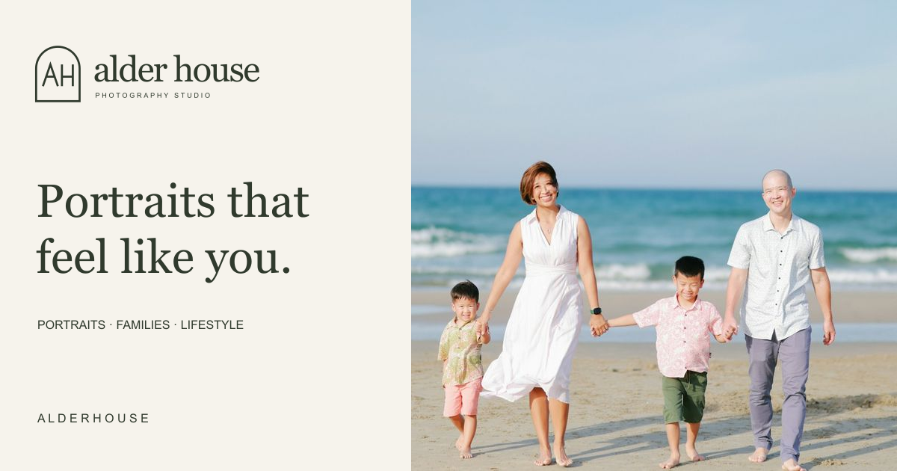

# <picture><source media="(prefers-color-scheme: dark)" srcset="public/brand/mark-light.svg"></picture> Alder House

[](https://github.com/smeltery/alder-house/actions/workflows/ci.yml)
[](https://github.com/smeltery/alder-house/releases)
[](https://astro.build)
[](https://www.sanity.io)
[](https://bun.sh)
[](https://flox.dev)
[](docs/vercel.md)
[](LICENSE)

[Visit the website](https://alder-house.vercel.app) · [Planning tools](https://alder-house.vercel.app/tools/)

A fictional photography studio for portraits, families, brands, and celebrations.
Astro serves the editorial site, six planning tools, and keyboard search; Sanity
manages portfolio stories and studio copy. The demo inquiry sends no personal data.
Vercel hosts the site and deploys pushes to `main`.



```sh
flox activate
bun install --frozen-lockfile
bun run dev
```

Open `http://127.0.0.1:4398`. The site starts with fictional content; connect a
separate Sanity project using the [CMS guide](docs/cms.md). Flox installs the
pre-commit hook automatically. Run `bun run verify` for the same checks as CI.

See [docs/](docs/README.md) for the visitor guide, CMS publishing workflow,
development, Vercel hosting, architecture, release operations, and image credits.

Code is distributed under the [license](LICENSE). Third-party photographs retain
their [separate terms](docs/assets.md).
