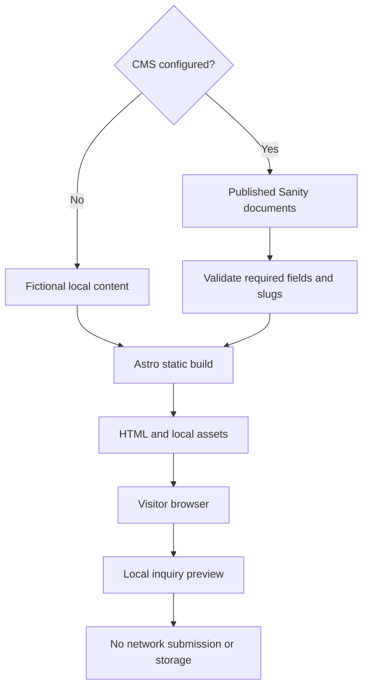

# Architecture

Astro renders static HTML. Shared layouts and components keep navigation, calls
to action, and story cards consistent. CSS supplies the visual system. The inquiry
uses a small browser script; React is needed only by Sanity Studio.

## Source map

| Path              | Responsibility                            |
| ----------------- | ----------------------------------------- |
| `src/pages/`      | Routes and static gallery generation      |
| `src/components/` | Story cards and closing invitation        |
| `src/layouts/`    | Document metadata, navigation, footer     |
| `src/lib/`        | Demo data and strict CMS loading          |
| `src/styles/`     | Responsive visual design                  |
| `studio/`         | Validated Sanity document schemas         |
| `scripts/`        | Shared verification and line budgets      |
| `tests/`          | Desktop/mobile journeys and accessibility |

## Boundaries

Sanity is read at build time with CDN caching disabled. Public data requires no
API token. Studio editing uses Sanity authentication. The website has no server,
login, private galleries, payment processor, email service, or inquiry storage.
Errors from a configured CMS stop generation. No configured project means an
explicit demo mode using local fictional stories.

The home follows a narrative of introduction, portfolio, studio philosophy,
experiences, process, and invitation. Content blocks share components where it
reduces duplication; the project intentionally avoids a general page builder.

## Session and interaction layers

`src/lib/session-details.ts` adds planning guidance to the shared session list.
One static route template produces all four session pages. Session descriptions
remain source-managed; portfolio stories and studio copy remain Sanity-managed.
The shared `SessionGuide` avoids repeating process markup across pages.

Browser scripts in `src/client/` handle the detailed inquiry preview and navigation
transitions. Native cross-document view transitions provide blur where supported;
standard links continue to work elsewhere, with an entry animation as fallback.
Modified clicks, downloads, external links, and same-page anchors keep normal
behavior. Back navigation clears the temporary blur; reduced motion disables it.
