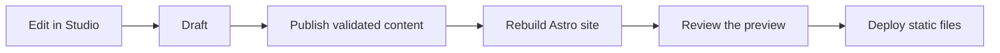

# Managing content with Sanity

Sanity Studio is retained as the editing interface. The public site is generated
at build time. No API credentials from another photography business are included.

## Connect a separate project

1. Create a new project in [Sanity Manage](https://www.sanity.io/manage), with a
   public dataset such as `production`. Account creation and billing remain yours.
2. Copy `.env.example` to `.env` and set all four identifiers below. The two project
   IDs must match, as must the two dataset names. Do not add API tokens.
3. Add `http://localhost:3333` as an allowed Studio origin in the project’s API
   settings. Enable credentials for this Studio origin, not arbitrary origins.
4. Run `flox activate`, `bun install --frozen-lockfile`, then `bun run studio`.
   Open `http://localhost:3333` and sign in with your Sanity account.

```dotenv
PUBLIC_SANITY_PROJECT_ID=your-project-id
PUBLIC_SANITY_DATASET=production
SANITY_STUDIO_PROJECT_ID=your-project-id
SANITY_STUDIO_DATASET=production
```

The project ID is an identifier, not a secret. Keep `.env` untracked. With both
public variables absent the site explicitly uses fictional demo content. Partial
configuration, fetch errors, and incomplete published content fail the build.

## Edit studio copy

Open **Studio copy**. Enter the home headline, home introduction, and studio story,
then publish. This is a single document, shared by the home and about pages.
Session descriptions live in `src/lib/demo.ts`; structural page copy remains in
Astro templates. The CMS owns portfolio stories and the three studio copy fields.

## Publish a portfolio story

1. Create a **Portfolio story** with a title and generated URL name.
2. Add the category, location caption, and story introduction.
3. Upload a cover and at least one gallery photograph. Describe each image in its
   alt-text field. Add the full session and drag images into narrative order; the
   gallery and viewer follow that order automatically. Only upload photographs
   you have permission to publish.
4. Enable **Show in the public portfolio** and publish the document.
5. Rebuild and deploy the website. Published edits appear after deployment, not
   immediately after pressing Publish. Preview locally before deploying.



Uncheck the public toggle and rebuild to remove a story from the site. Publishing
makes the data readable in the public dataset even when this toggle is off; the
toggle controls website inclusion, not confidentiality. This is not a private
client-delivery system. Studio requires Sanity authentication to edit.

## Studio hosting and verification

`bun run studio:build` produces `dist/studio/` with your identifiers. Host it
separately from the public website and allow its exact origin in Sanity. Run the
website build before the Studio build when building both locally, since Astro
cleans `dist/`. A deployed Studio continues to require a Sanity login.

CI checks that Studio compiles using a non-connected example project identifier.
A successful CI run does not verify live credentials or dataset permissions.
