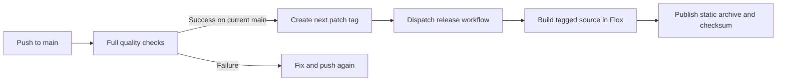

# Deployment and releases

## Host the website

Build with `bun install --frozen-lockfile && bun run build`, then publish `dist/`
on a static host such as Vercel or Netlify. Use Node 24 and Bun 1.3.11, or build
inside the locked Flox environment. Configure the host to serve directory index
files and `404.html` for missing routes.

For live content, set `PUBLIC_SANITY_PROJECT_ID` and `PUBLIC_SANITY_DATASET` in the
hosting build environment. A demo needs neither. Trigger a host rebuild after
publishing content. An optional Sanity webhook can trigger the host’s private
build-hook URL; keep that URL out of the repository. No webhook is provisioned.

## Quality gates

Pushes to main, pull requests, and manual runs execute the `ci` workflow in Flox.
It validates formatting, Markdown, Mermaid, local documentation links, source
budgets, TypeScript, Astro, and workflow syntax. It builds both website and Studio
and exercises desktop/mobile pages, accessibility, galleries, and demo inquiries.
The hook runs the same script. Browser failures upload diagnostic traces.

## Automatic releases

`auto-release` runs only for successful push CI on main in this repository. It
checks that the tested commit is still main before tagging it. The first tag is
`v0.1.0`; subsequent untagged commits increment the patch. Existing tags are reused,
so rerunning the workflow can recover an interrupted release dispatch.

The release workflow validates its tag, builds that exact revision, and publishes
`alder-house.tar.gz` and its SHA-256 checksum. Releases contain the fictional demo;
production CMS builds belong to your host. GitHub Actions must have write access
to contents and permission to dispatch workflows. No personal token is required.

A release does not deploy a live website. Enable your chosen host separately.
For recovery, rerun `release` manually with the existing version tag. Uploads are
idempotent. Never move a published tag; publish a new patch for corrections.
