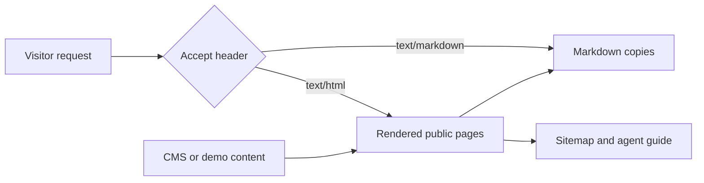

# Search and agent discovery

Public pages have canonical URLs, social metadata, and structured data identifying
Alder House as a fictional demonstration. No physical business address, booking
availability, or contact details are invented for search engines.

The build generates a sitemap, robots rules, `llms.txt`, `llms-full.txt`, and
Markdown copies from the actual rendered pages, including published CMS galleries.
The studio editor is excluded. Interactive planning calculations still need a browser.



Vercel middleware negotiates Markdown when explicitly requested. Both representations
send `Vary: Accept`. Missing Markdown routes return HTTP 404 with recovery links;
upstream failures return 503. Ordinary visitors continue to receive the website.
Static hosts without middleware can serve the generated `/agent-content/` files directly.

## Verify a deployment

```sh
curl -i -H 'Accept: text/markdown' https://alder-house.vercel.app/
curl -i -H 'Accept: text/html' https://alder-house.vercel.app/
curl -i -H 'Accept: text/markdown' https://alder-house.vercel.app/missing-page/
bunx is-agentic alder-house.vercel.app --json
```

The is-agentic audit includes external search visibility and may cache reports.
A fresh deployment cannot guarantee search-engine indexing or a particular score.
Run `bun run verify` for local validation; Markdown negotiation is unit tested and
must also be checked on Vercel because Astro preview does not run edge middleware.
