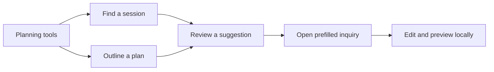

# Planning tools and search

Open **Planning tools** from the main navigation, mobile menu, or footer.
The session finder (`/tools/session-finder/`) suggests one of four experiences
from your chosen goal. The session planner (`/tools/session-planner/`) gathers a
session type, setting, group, and image priority into an editable starting point.
Neither tool provides a quote or makes a booking.

Choose **Discuss this plan** to prefill the inquiry. Only the predefined planning
choices appear in that link. Names, contact details, and free-text form entries
are never added. Choices are not saved in browser storage. You can change any
prefilled field before previewing your inquiry. **Start again** clears a tool.
Without JavaScript, follow the links to compare sessions or start an inquiry.

Use the header search button, **Cmd+K** on Mac, or **Ctrl+K** elsewhere to find
pages, planning tools, session experiences, and published portfolio stories.
Type to filter, use up/down arrows to browse results, and Enter to open a result.
Escape closes search and restores focus. Search runs locally and sends no query
to a search service. The CMS supplies portfolio titles at build time.

## More ways to prepare

The wardrobe guide (`/tools/wardrobe-guide/`) offers three setting-based palettes
with named colors, coordination tips, and practical clothing suggestions.
The brand shot-list builder (`/tools/brand-shot-list/`) turns a website refresh,
social storytelling, or product launch into a list of images to discuss.
**Discuss these ideas** carries the generated guide into the inquiry’s editable
plans field. Brand shot lists also select the brand session. Generated guide text
appears in that link; no personal details are requested by these tools.

Filter the tools directory by Getting started, Session preparation, or For
businesses. The search dialog has All, Pages, Tools, and Contact filters;
filters combine with your search text. Results include descriptions and are
grouped by category. Use **All planning tools** to return from any tool.

Each tool includes jump links, three practical tips, an example, and a question
about using its result. Directory filters announce the number of matching tools.

## Location and preparation

The location finder (`/tools/location-finder/`) suggests a type of setting from
four atmosphere preferences. It includes practical trade-offs; it does not look
up venues, permissions, forecasts, or availability. Its inquiry link prefills
the setting and discussion notes.

The preparation checklist (`/tools/preparation-checklist/`) provides four
checkable tasks for each session type. Progress updates locally and is cleared
by a reset, a new choice, or a reload. The inquiry includes the full checklist
and selected session, not the tick marks.
