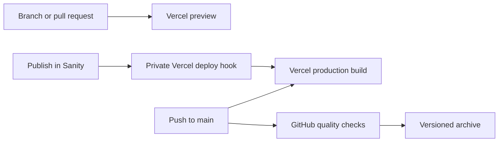

# Hosting on Vercel

Import `smeltery/alder-house` into your Vercel team and use `main` as the production
branch. The repository’s `vercel.json` selects Astro, installs the locked Bun
dependencies, builds the website, and publishes `dist/`. No server adapter or
runtime functions are needed. The Sanity editor remains separately hosted.

## Environment variables

| Variable                   | Purpose                                                                           |
| -------------------------- | --------------------------------------------------------------------------------- |
| `PUBLIC_SITE_URL`          | Full public origin, such as `https://your-domain.example`, for social image URLs. |
| `PUBLIC_SANITY_PROJECT_ID` | Your separate Sanity project; leave unset for the fictional demo.                 |
| `PUBLIC_SANITY_DATASET`    | Published content dataset; set together with the project ID.                      |

Apply variables to the appropriate Production and Preview environments, then
redeploy. Do not reuse an unrelated client dataset. Studio variables belong to
its separate deployment; see the [CMS guide](cms.md).

## Publishing flow

Vercel’s Git integration deploys independently of GitHub’s quality workflow.
Review checks before merging changes to main. Releases provide downloadable
archives and do not themselves deploy Vercel. A CMS publish needs a rebuild;
configure a private Vercel deploy hook in Sanity if automatic publishing is wanted.
Never commit the deploy-hook URL.

## Domains and verification

Add a domain in Vercel’s project settings, follow its DNS instructions, and set
`PUBLIC_SITE_URL` to that origin. Verify the home page, a portfolio story, planning
tools, `/inquire/`, and an unknown route. The demo inquiry remains browser-only.
Preview deployments may require Vercel authentication depending on team settings.

Vercel supports [static Astro deployments](https://vercel.com/docs/frameworks/frontend/astro)
and [repository build configuration](https://vercel.com/docs/project-configuration/vercel-json).
For local parity and full validation, use `flox activate -- bun run verify`.
