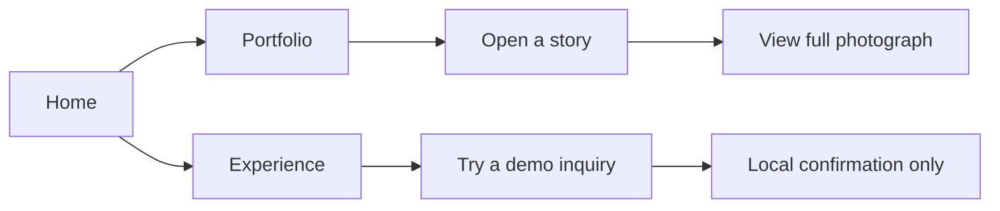

# Using Alder House

## Explore a story

Choose **Portfolio** to see the public portfolio, then select a story. Each story
contains an introduction, photo count, and an ordered gallery. Select a photograph
to open the full-screen viewer. Use Previous/Next, arrow keys, or swipe on the
image. Home/End jump to the first/last photo. Escape or Close returns focus to
the photograph you opened. **Next story** continues to another collection.
Without JavaScript, photograph links still open the image directly.

## Find an experience

**Sessions** introduces portraits, families, brands, and celebrations. Expand
the questions for details. **The studio** explains the studio’s imagined approach.
There are no real prices, customer testimonials, or appointments.

## Try an inquiry

Choose **Start a conversation**. Enter sample name and email details, select a
session, and describe an imagined day. The date is optional. **Preview your
inquiry** displays a local confirmation: nothing is sent or saved. **Try another
story** clears the form. JavaScript is required for this demonstration.

## Privacy and access

The inquiry uses no network submission, cookies, or browser storage. Google Fonts
may receive a normal font request. Published Sanity images load from Sanity’s CDN;
demo photographs are hosted with the site. Every gallery is public. Do not upload
private client photographs or treat a gallery URL as access control.

Navigation works by keyboard, includes a skip link, and adapts to narrow screens.
Reduced-motion preferences disable decorative transitions. Image sources are
listed on the site’s **image credits** page and in [asset documentation](assets.md).

On mobile, **Menu** opens a navigation panel. Choose a page, use **Close menu**,
or press Escape. Keyboard focus stays inside the panel until it closes. The
footer groups sessions and studio pages, with a privacy link and **Back to top**.

## Plan a specific session

Each session has its own page: portraits, families, brands, or celebrations.
Compare planning time, included elements, clothing and location guidance, and
common questions. **Plan this session** carries your choice into the inquiry.
These outlines are illustrative; no live prices or availability are advertised.

## A more useful introduction

The inquiry groups your contact details, session plans, and priorities. Name,
email, session type, location, and a short description are required. Timing,
budget, participants, inspiration, and comfort preferences are optional. Use
sample information only. Budget ranges provide planning context, not quotes.
Select the kinds of photographs you want, then preview a summary of the session,
setting, timing, and priorities. Editing the form hides the outdated preview;
**Try another story** clears it. No data leaves the page.

## Brand resources and motion

**Brand resources** in the footer contains downloadable logos, the monogram,
favicon, touch icon, palette, and visual guidance. Blur transitions soften page
changes and mobile-menu opening. Reduced-motion preferences disable these effects.
